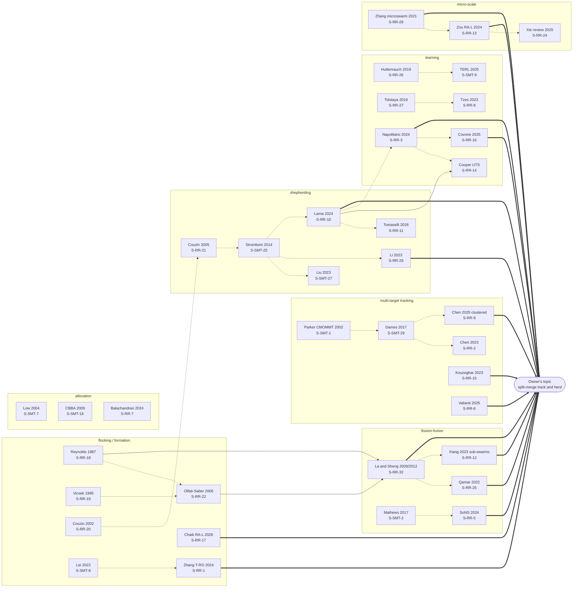

# 최근 문헌 검토: 분열-융합 추적과 몰이 군집 (recent review)

- 작업 태그: RR (새 출처는 `S-RR-n`). 기존 survey 출처는 `S-SMT-n`으로 그대로 인용한다.
- 조사일: 2026-11-10
- 상태: 한 회차 완료. 검색과 읽기 약 70회.
- 앞선 조사: `survey.md`. 그 내용은 되풀이하지 않는다.

## 요약

- **결론: 다중 몰이꾼 배정과 무리 표적 추적에는 선행 연구가 더 있다. 표적 무리가 반복해서 갈라지고 합칠 때의 비례 재배정과 그 맞교환은 여전히 출처를 못 찾았다.**
- survey의 다중 몰이꾼 배정 빈틈(§13.3 항목 1)은 좁혀졌다. 부분 무리 단위 배정도 Hu 등 2020이 있다고 [S-RR-29]가 쓴다 (표 4).
- survey의 다른 "못 찾음"은 남는다: 반복 분열-융합 맞교환, 관측·몰기 역할, 탐색에서 몰이까지, 소 현장 몰이.
- survey §13.3은 메인 세션이 고쳐야 한다. 이 작업은 survey.md를 고치지 않았다.
- 상위 확장 지점 5개: 표 5의 순위 1–5.
- 최근 논문 표(표 1): 22편. verified 17, partial 4, unverifiable 1.
- 새 출처(S-RR) 전체: 32개. verified 22, partial 9, unverifiable 1.
- 표 1 밖에서 다시 인용한 survey 출처(S-SMT): 기간 안 4개 (표 1 아래 목록).
- 미해결 질문 15개: open_questions.

## 1. 최근 논문 표 (2023–2026)

표 1. 최근 논문, 한 행에 한 편.

| ID | 연도 | 학회·학술지 | 제목 | 문제 | 방법 | 결과·주장 | 저자가 밝힌 한계 | 검증 |
| --- | --- | --- | --- | --- | --- | --- | --- | --- |
| [S-RR-1] | 2024 | IEEE T-RO 40 | Heterogeneous Targets Trapping With Swarm Robots by Using Adaptive Density-Based Interaction | 강도가 다른 표적(약함, 강함, 무리 이동)을 가둔다 | 밀도 기반 지역 상호작용. 적응 배정과 변형 기전 | 포위 두께와 무리 크기를 표적 강도에 맞춘다. 실물 로봇 최대 50대 실험 | 초록에 없음 | verified: 초록 (OpenAlex) |
| [S-RR-2] | 2023 (v2 2024) | arXiv | Distributed Multi-Robot Multi-Target Tracking Using Heterogeneous Limited-Range Sensors | 이종 센서망의 다중 표적 추적 정확도 | "정규화된 미사용 감지 용량" 지표로 분산 커버리지 제어 | 로봇 운영 체제(Robot Operating System, ROS)와 MATLAB 시뮬레이션에서 이종성을 무시한 방법보다 낫다 | 초록에 없음 | verified: 초록 |
| [S-RR-3] | 2024 | arXiv. 관련 DOI가 ECC 2025를 가리킨다 (inference) | Emergent Cooperative Strategies for Multi-Agent Shepherding via Reinforcement Learning | 응집하지 않는 표적의 다중 몰이꾼 몰이 | 분산 강화 학습 두 층: 아래 층은 표적 하나 가두기, 위 층은 표적 고르기 | 몰이꾼이 서로 다른 표적을 스스로 고른다. 적은 에이전트로 학습한 정책을 큰 규모에 쓴다 | 초록에 없음. 수치 없음 | verified: 초록 |
| [S-RR-4] | 2025 | arXiv | Decentralized Shepherding of Non-Cohesive Swarms Through Cluttered Environments via Deep Reinforcement Learning | 장애물 속에서 흩어지는 표적 무리 몰이 | 위 층 배정 규칙 + 아래 층 [근접 정책 최적화(proximal policy optimization, PPO)](#term-ppo) 정책. 1대 1, 장애물 1개로 학습 | 재학습 없이 다중 몰이꾼, 다중 장애물에서 표적이 목표에 모인다 | 시뮬레이션만 (inference, 초록 기준) | verified: 초록 |
| [S-RR-5] | 2024 | Science Robotics 9, eadl5161 (arXiv 2401.13103) | Self-organizing Nervous Systems for Robot Swarms | 고정 구조의 한계: 분산형은 설계가 어렵고, 중앙형은 단일 고장점이 있다 | 스스로 생기는 계층(self-organized hierarchy). 로봇이 임시 다층 계층을 만들고 다시 짠다 | 군집 n대가 n대짜리 계층 하나가 되고, 다시 작은 독립 계층 여럿으로 나뉜다. 실물 공중-지상 이종 군집, 시뮬레이션 최대 250대 | 초록에 없음 | verified: 초록 (arXiv). 학술지 정보는 검색 요약 |
| [S-RR-6] | 2025 | arXiv | Cooperative Search and Track of Rogue Drones using Multiagent Reinforcement Learning | 시설 위의 불법 드론 여러 대를 찾고 추적한다 (응용은 소유자 주제와 다르다. 방법만 참고) | [다중 에이전트 강화 학습(multi-agent reinforcement learning, MARL)](#term-marl)으로 추격 무인 항공기의 이동을 정한다 | 시뮬레이션에서 에이전트 수를 바꿔 성능과 확장성을 보였다. 수치는 초록에 없음 | 시뮬레이션만 (inference) | verified: 초록 |
| [S-RR-7] | 2024 | arXiv | Swarm Algorithms for Dynamic Task Allocation in Unknown Environments | 작업이 모르는 곳에 계속 나타날 때 군집 배정 | 정보 전파, 분업(일부는 Lévy 걷기), 둘을 오가는 혼합 | 작업 발생이 느리거나 중간이면 분업과 혼합이 낫다. 빠르면 Lévy 걷기가 같거나 낫다 | 이산 모형 (초록 기준) | verified: 초록 |
| [S-RR-8] | 2022 (ICRA 2023) | arXiv, ICRA 2023 제출 | Graph Neural Networks for Multi-Robot Active Information Acquisition | 통신 그래프 위 로봇 팀의 능동 정보 수집. 표적 추적 포함 | [그래프 신경망(graph neural network, GNN)](#term-gnn) I-GBNet. 중앙 전문가 해법을 모방 학습 | 학습보다 큰 그래프와 새 환경에 일반화. 동적 표적 추적에서 보였다 | 초록에 없음. 중앙 전문가에 의존 (inference) | partial: 초록. 학회 게재와 수상은 검색 요약만 |
| [S-RR-9] | 2025 | Autonomous Robots 49(2) | Effective tracking of unknown clustered targets using a distributed team of mobile robots | 모이는 표적(예: 동물 무리)을 찾고 추적한다 | 추정기 둘: 현재 표적 상태와 무리 위치의 장기 지도. power diagram으로 탐색 영역을 나눈다 | 무리 표적에서 다른 방법보다 추적 정확도가 높다. 고른 분포 표적에서도 잘 된다 | 초록에 없음. 시뮬레이션 (초록 기준) | verified: 초록 (Crossref) |
| [S-RR-10] | 2023 (v2 2024) | arXiv (검색 요약상 Physical Review Research 2024) | Shepherding control and herdability in complex multiagent systems | 응집하지 않는 표적, 지역 감지 몰이꾼. 표적 수 대비 필요한 몰이꾼 수 | 비례 법칙(scaling law). "herdability graph"의 퍼콜레이션(percolation). 1차원 [편미분 방정식(partial differential equation, PDE)](#term-pde) | 표적 밀도가 임계값 아래면 필요한 몰이꾼 수가 크게 늘어난다 | 해석은 단순 1차원뿐 (inference, 초록 기준) | verified: 초록. 학술지는 검색 요약 |
| [S-RR-11] | 2026 | ICRA 2026 (arXiv 2604.22327) | Multi-robot obstacle-aware shepherding of non-cohesive target agents | 장애물 속, 서로 협조하지 않는 표적 몰이 | 혼합 정책: 목표 쪽 직접 조향 + 장애물 접선 따라 돌기 | 시뮬레이션에서 기존 몰이 방법보다 가둠 비율이 높다. TurtleBot4 몰이꾼과 실물 표적 로봇으로 실내 실험 | 초록에 없음 | verified: 초록 (게재는 comments 기준) |
| [S-RR-12] | 2023 | arXiv | Dynamic UAV Swarm Collaboration for Multi-Targets Tracking under Malicious Jamming: Joint Power, Path and Target Association Optimization | 전파 방해 속 다중 표적 추적. 통신 간섭이 추적을 망친다 | 세 부분 문제로 나눈다. 무리 진화 표적 연결(cluster-evolutionary target association, CETA)이 군집을 부분 군집으로 나눠 표적에 짝짓는다. 인공 퍼텐셜장 경로, 평균장 게임 출력 제어 | 기준선보다 평균 간섭 28%, 추적 단계 33%, 표적 전환 48% 줄었다. 본문: 부분 군집 수 = 표적 수. 중심에서 가장 가까운 표적이 바뀔 때만 다시 짝짓는다(사건 기반) | 표적은 서로 다른 방향으로 곧게 가며 갈라지거나 합치지 않는다. 비행 에너지는 무시한다. 시뮬레이션만 | verified: 본문 앞 100000자 |
| [S-RR-13] | 2024 | IEEE RA-L 9(10) | Automatic Navigation of a Microrobotic Swarm for Tracking Multiple Mobile Targets | 자기장 구동 미세 로봇 군집으로 이동 표적 여럿 추적 | [최적화 빠른 탐색 무작위 트리 스타(optimized rapidly-exploring random tree star, ORRT*)](#term-orrt) 경로 + 최단 경로 선택 + 슬라이딩 모드 제어 | 가상 미로에서 시뮬레이션과 실험으로 다중 이동 표적 추적을 보였다 | 미세 군집은 탑재 센서와 구동기가 거의 없다고 쓴다. 군집 하나가 표적을 차례로 따른다 (inference) | verified: 1쪽 |
| [S-RR-14] | 2025 이후 (inference) | 미확인 (UTS 저장소) | Emergent Herding Behaviour Through Decentralised Reinforcement Learning | 드론 팀의 가축 몰이 | 분산 강화 학습. 반발-끌림 보상과 단계 학습(간격, 포위, 유도 순) | 지역 관측과 최소 통신으로 확장 가능한 몰이. 여러 행동 조건에서 시뮬레이션 성공 | 초록에 없음. 시뮬레이션만 (inference) | partial: 1쪽. 학회와 연도 미확인 (본문이 Napolitano 2025를 인용) |
| [S-RR-15] | 2023 | ICRA 2023 (arXiv 2303.01799) | Multi-Target Pursuit by a Decentralized Heterogeneous UAV Swarm using Deep Multi-Agent Reinforcement Learning | 모르는 환경에서 빠르게 도망가는 표적 여럿을 추격 | 역할 기반 [다중 에이전트 심층 결정 정책 경사(multi-agent deep deterministic policy gradient, MADDPG)](#term-maddpg). 일부는 탐색, 일부는 추적. Voronoi 기반 탐색 보상 | 협력 정책을 배웠다. Crazyflie 실물 드론에서 확인 | 초록에 없음. 수치 없음 | verified: 초록 (게재는 comments 기준) |
| [S-RR-16] | 2025 | arXiv | Hierarchical Policy-Gradient Reinforcement Learning for Multi-Agent Shepherding Control of Non-Cohesive Targets | 응집하지 않는 표적의 다중 몰이꾼 몰이 | [근접 정책 최적화(proximal policy optimization, PPO)](#term-ppo) 두 층: 위 층 표적 고르기, 아래 층 몰기. 이전의 이산 행동 [심층 Q 신경망(deep Q-network, DQN)](#term-dqn) 방식을 연속 행동으로 바꾼다 | 표적 수가 늘어도 수렴. 제한된 감지에서도 된다. 궤적이 부드럽다 | 초록에 없음. 수치 없음 | verified: 초록 |
| [S-RR-17] | 2026 | IEEE RA-L 11(6) | Safe and Adaptive Multi-Target Encirclement With Socially Aware Multi-Robot Control | 속도를 모르는 이동 표적 무리를 둘러싸고 추적한다 | 로봇마다 표적 무리의 볼록 껍질(convex hull)과 안전 거리를 지킨다. 안전 거리는 사회적 제약으로 정한다. 고른 기하 분포를 유지한다 | 분포의 안정성을 형식적으로 분석했다. 시뮬레이션과 외바퀴 모형(unicycle) 로봇 실물 시험. 다른 방법보다 안전성과 적응성이 높다 | 초록에 없음. 무리가 갈라지는 경우는 초록에 없음 | verified: 초록 (OpenAlex) |
| [S-RR-23] | 2024 | Information Sciences 661 | Self-organized swarm robot for multi-target trapping based on self-regulated density interaction | 지역 감지만으로 여러 표적 가두기. [S-SMT-8]과 같은 저자(Lei)의 같은 갈래 (inference) | 밀도 음의 되먹임으로 밀도를 최적 수준에 유지. 밀도-거리 가중 표적 선택 | 명시적 통신 없이 가둔다. 수치 시뮬레이션과 실물 로봇 실험 | 확인 못함 | partial: 검색 요약만. 도서관 기록 HTTP 404 |
| [S-RR-24] | 2025 | Research 8, 0686 (리뷰) | Microrobotic Swarms for Cancer Therapy | 미세 로봇 군집으로 암 치료. 설계, 표적 도달, 영상 | 리뷰. 외부장 구동(자기, 전기, 빛, 소리), 몸속 영상(형광, [자기 공명 영상(magnetic resonance imaging, MRI)](#term-mri), 초음파, 광음향) | 군집 농도가 높으면 영상 대비가 좋아진다 | 소동물 모형에서만 검증. 사람 크기 구동 없음. 몸속 영상 미숙. 동적 종양 환경에서 제어 안정성과 정밀도가 어렵다 | verified: 본문 앞 절반 |
| [S-RR-29] | 2023 | Frontiers in Control Engineering 4 | Communication-free shepherding navigation with multiple steering agents | 몰이꾼 여럿이 중앙 조정과 통신 없이 몬다 | [가장 먼 개체 겨누기(farthest-agent targeting, FAT)](#term-fat) 확장. 목표 거리와 자기 거리를 저울질해 표적 양을 고른다. 몰이꾼끼리 밀어낸다 | 기준 모형에서 성공률 거의 100%. 가장 먼 개체 겨누기(farthest-agent targeting, FAT)보다 완료 시간과 경로가 짧다. 몰이꾼 고장 확률 0.4까지 견딘다 | 수렴 증명 없음. 수치 실험만, 실물 없음. 몰이꾼이 같은 양을 고르기도 한다 | verified: 본문 |
| [S-RR-30] | 2023 | 업체 블로그 (Clearpath) | Mississippi State University advances livestock management with automated herding systems | 지상 로봇으로 젖소를 몬다 | Warthog [무인 지상 차량(unmanned ground vehicle, UGV)](#term-ugv), 카메라, 위성 위치, 라이다 | 개념 증명 시험. 수치 결과 없음 | 예비 단계. 자율 알고리즘 미완성. 사람을 뺄 수 없다고 쓴다 | partial: 2차 출처 (업체 글) |
| [S-RR-31] | 미확인 | MLA 보고서 P.PSH.1374 | Livestock Mustering with Drones and Pathways to Adoption | 드론으로 가축 모으기 | 현장 시험 (검색 요약만) | 검색 요약의 시험 횟수와 날짜는 다른 과제 번호(P.PSH.1491)와 섞여 있다. 쓰지 않는다 | 확인 못함 | unverifiable: 페이지가 제목만 준다. 과제 번호와 날짜의 대응 미해결 [UNVERIFIED] |
<!-- rows-end -->

- 기간 안의 survey 출처는 다시 행으로 쓰지 않는다. 그대로 인용한다.
  - [S-SMT-8] Lei 등 2023: 밀도 기반 다중 표적 가두기.
  - [S-SMT-9] 트랜스포머 강화 강화 학습(Transformer-Enhanced Reinforcement Learning, TERL) 2025: 학습한 다중 표적 포위.
  - [S-SMT-17] 2023: 위험에서 무리 돌리기.
  - [S-SMT-27] Liu 등 2023: 흩어진 무리를 묶고 모으는 순서를 계획.
- "초록에 없음"은 그 논문이 안 했다는 뜻이 아니다. 초록만 읽었다는 뜻이다.

## 2. 분석

### 2.1 (a) 과거의 문제와 해결 흐름

표 2. 시기별 문제와 해결. "해결"의 내용 일부는 서지만 확인한 논문에 기댄다 (표 6의 출처 칸).

| 시기 | 그때의 문제 | 해결 방식 | 출처 |
| --- | --- | --- | --- |
| 1987–1995 | 단순한 개체 규칙으로 집단 운동이 나오나? | 지역 규칙(붙기, 피하기, 맞추기). 잡음 속 방향 맞춤의 상전이 | [S-RR-18], [S-RR-19] (내용은 inference) |
| 2002–2006 | 그 운동을 설명하고 증명할 수 있나? | 동물 무리 모형과 정보 가진 소수의 이끌기. 무리 짓기의 안정성 이론 | [S-RR-20], [S-RR-21], [S-RR-22] (내용은 inference) |
| 2002–2004 | 표적이 로봇보다 많거나 움직일 때 누가 무엇을 보나? | 협력 다중 로봇 다중 이동 표적 관측(cooperative multi-robot observation of multiple moving targets, CMOMMT). 표적 수에 비례한 배치 | [S-SMT-1], [S-SMT-7] |
| 2009–2012 | 새 표적이 나타나면 누가 대형에서 떨어져 나가나? | 센서망의 분열과 융합. 씨앗 성장 그래프 분할(seed growing graph partition, SGGP) | [S-RR-32], [S-SMT-6] |
| 2009 | 중앙 배차 없이 작업을 나눌 수 있나? | 합의 기반 묶음 알고리즘(consensus-based bundle algorithm, CBBA) | [S-SMT-18] |
| 2014 | 몰이꾼 하나가 무리를 어떻게 모으고 미나? | 모으기와 밀기를 오가는 규칙 | [S-SMT-25] |
| 2017 | 수를 모르는 표적을 찾으면서 추적할 수 있나? 로봇 몸이 합치고 나뉠 수 있나? | 확률 가설 밀도 필터(probability hypothesis density filter, PHD filter)와 Lloyd 분할. 병합 가능한 신경계 | [S-SMT-29], [S-SMT-2] |
| 2018–2019 | 학습 정책이 로봇 수에 따라 무너진다 | 평균 임베딩(mean embedding). 그래프 신경망(graph neural network, GNN)으로 지역 통신만 쓰는 제어기 | [S-RR-26], [S-RR-27] |
| 2021–2022 | 미세 군집과 드론 군집도 나뉘고 합칠 수 있나? | 외부 자기장 매개변수로 미세 군집 분열과 융합. 강화 학습 드론 군집이 표적 수대로 나뉘고 다시 합친다 | [S-RR-28], [S-RR-25] |

### 2.2 (b) 지금 다루는 문제 (2023–2026)

```
 2023–2026 연구의 공통 방향 (inference)
 고정 규모 → 규모 일반화      응집 표적 → 흩어지는 표적      시뮬레이션 → 실물·현장
 [S-SMT-9][S-RR-3][S-RR-8]   [S-RR-10][S-RR-16][S-RR-11]    [S-RR-1][S-RR-11][S-RR-30]
```

표 3. 지금 다루는 문제.

| 문제 | 대표 논문 | 상태 |
| --- | --- | --- |
| 학습 정책이 더 많은 로봇과 표적에 일반화되나 | [S-SMT-9], [S-RR-3], [S-RR-8] | 적은 수로 학습하고 큰 수에서 시험한다 |
| 표적이 서로 붙어 다니지 않을 때의 몰이 | [S-RR-10], [S-RR-3], [S-RR-16], [S-RR-4], [S-RR-11], [S-RR-29] | 몰이꾼마다 표적 하나를 고른다. 필요한 몰이꾼 수의 임계 밀도가 있다 |
| 표적과 센서가 이종일 때 | [S-RR-1], [S-RR-2] | 표적 강도에 맞춘 포위 두께. 미사용 감지 용량으로 일 나누기 |
| 모여 있는 표적 무리 | [S-RR-9], [S-RR-17] | 무리 지도와 power diagram. 무리의 볼록 껍질 둘레 안전 포위 |
| 표적 수에 맞춘 부분 군집 나누기 | [S-RR-12] | 부분 군집 수 = 표적 수. 사건 기반 재연결. 방법 전체가 기준선보다 표적 전환을 48% 줄였다 |
| 다시 짜는 제어 구조 | [S-RR-5] | 계층 하나가 작은 계층 여럿으로 나뉜다 |
| 찾기와 추적의 역할 나눔 | [S-RR-15], [S-RR-6] | 탐색 역할과 추적 역할을 학습한다 |
| 작업이 계속 나타나는 배정 | [S-RR-7] | 정보 전파와 무작위 걷기의 혼합 |
| 드론과 지상 로봇의 실제 몰이 | [S-RR-14], [S-RR-30], [S-RR-31] | 시뮬레이션 또는 개념 증명. 동료 심사 현장 연구는 못 찾았다 |
| 미세 군집의 다중 이동 표적 | [S-RR-13], [S-RR-24] | 군집 하나가 표적을 차례로 따른다. 몸속 영상과 제어 정밀도가 과제 |

### 2.3 (c) 아직 열린 문제

survey.md(§3, §13.3)의 빈틈과 맞춰 본다. "못 찾음"은 이번 조사의 범위에서다 (`rules/research.md` §10).

표 4. survey 빈틈의 변화.

| survey의 "못 찾음" | 이번 조사 뒤 | 근거 |
| --- | --- | --- |
| §13.3 항목 1: 몰이꾼 여럿을 부분 무리에 나눠 보내는 분산 배정 | **좁혀짐.** 몰이꾼이 표적 개체를 고르는 분산 방법이 셋 있다. [S-RR-29]의 관련 연구 절은 Hu 등 2020을 든다: 분산 묶기로 어느 몰이꾼이 어느 부분 무리를 몰지 합의한다. 통신이 여러 번 필요하다. Lee와 Kim 2017도 부분 무리를 다룬다. 두 원문은 읽지 않았다 | [S-RR-3], [S-RR-16], [S-RR-29] |
| §3: 반복 분열-융합에서 관측률 대 전환 빈도 | **남음.** 표적 전환을 잰 논문은 표적이 갈라지지 않는다. 표적 수대로 나누는 논문은 2쪽까지 전환 지표가 없다. Hu 등 2020은 묶기를 주기적으로 돌리지만, 반복 분열은 [S-RR-29]의 서술에 없다 | [S-RR-12], [S-RR-25], [S-RR-29] |
| §13.3 항목 2: 몰이 도중 무리가 반복해서 갈라지고 합치는 조건 | **남음** | 못 찾음 |
| §13.3 항목 3: 관측과 몰기의 역할 나눔과 비율 | **남음.** 탐색과 추적의 역할 나눔은 있다 | [S-RR-15] |
| §14.1: 탐색 다음 몰이까지 잇는 연구 | **남음.** 무리 표적의 탐색과 추적은 함께 다룬다. 몰이는 없다 | [S-RR-9] |
| §13.1: 소를 드론이나 로봇으로 모는 현장 연구 | **남음.** 업체 글과 미확인 보고서뿐이다 | [S-RR-30], [S-RR-31] |

- [S-RR-10]은 빈틈이 아니라 survey 연구 질문(research question, RQ) 4와 5에 답의 재료를 준다: 표적 밀도 임계값 아래에서 필요한 몰이꾼 수가 크게 는다.
- [S-RR-9]는 survey §2의 "표적 무리 구조를 다루는지" 물음에 닿는다: 무리 표적을 따로 다룬다.

남은 열린 문제 (inference, 아래 근거 논문의 초록과 앞쪽 기준):

1. 표적 **무리**가 반복해서 갈라지고 합칠 때의 지역 비례 재배정. 추적 쪽은 표적 개체 단위로 나눈다 [S-RR-12], [S-RR-25]. 몰이 쪽 부분 무리 배정(Hu 등 2020, [S-RR-29] 인용)은 합의 통신이 필요하고, 반복 분열은 서술에 없다.
2. 관측률과 전환 빈도의 맞교환 곡선. 전환 횟수는 잰다 [S-RR-12]. 하지만 이력 시간을 바꿔 가며 곡선을 그린 출처는 못 찾았다.
3. 로봇이 옮겨 갈 때 대형 크기를 다시 맞추기. 포위 두께를 표적 강도에 맞춘다 [S-RR-1]. 로봇 수 변화에 맞춘 크기 조절은 초록에 없다.
4. 추적에서 몰이로 넘기기. "관측" 역할과 "몰기" 역할의 비율. 찾기와 추적의 역할 나눔은 있다 [S-RR-15]. 몰기와 관측의 나눔은 못 찾았다.
5. 몰이 도중 부분 무리가 다시 갈라질 때 몰이꾼을 무리 크기에 비례해 다시 나누는 문제. 최근 학습 방법은 표적 개체 하나를 고른다 [S-RR-3], [S-RR-16]. 부분 무리 단위 배정은 Hu 등 2020과 Lee와 Kim 2017이 있다고 [S-RR-29]가 쓴다. 두 원문은 읽지 않았다. 무리 단위 모으기 순서는 몰이꾼 하나에 있다 [S-SMT-27].
6. 소 떼의 다중 로봇 현장 몰이. 동료 심사 연구는 못 찾았다. 있는 것은 시뮬레이션 [S-RR-14], 업체 글 [S-RR-30], 미확인 보고서 [S-RR-31].
7. 동물 복지 제약을 넣은 다중 로봇 몰이. 단일 드론 연구만 있다 [S-SMT-28]. 사회적 안전 거리 포위는 있다 [S-RR-17].
8. 미세 군집이 여러 세포 무리를 **동시에** 추적. 지금은 군집 하나가 차례로 간다 [S-RR-13]. 장 매개변수로 나누기는 된다 [S-RR-28]. 둘을 묶은 출처는 못 찾았다.
9. 평가가 대부분 시뮬레이션이다. 실물 시험은 일부다 [S-RR-1], [S-RR-11], [S-RR-15].

### 2.4 (d) 소유자 주제의 확장 지점

- 모두 inference다. 각 지점은 확장할 논문, 더할 것, 파이프라인 단계를 쓴다.
- 파이프라인 단계: 1 펼치기, 2 탐색, 3 탐지·묶기, 4 분열·배정, 5 추적, 6 몰이 (survey §14).

표 5. 확장 지점. 순위 1–5가 상위 5개다.

| 순위 | 확장할 논문 | 더할 것 | 단계 | 연구 질문 |
| --- | --- | --- | --- | --- |
| 1 | [S-RR-12] 부분 군집 = 표적 수, 사건 기반 재연결 | 표적을 반복해서 갈라지고 합치는 **무리**로 바꾼다. 재연결에 이력 시간 T를 넣는다. T를 바꿔 관측률 대 전환 빈도 곡선을 그린다 | 4 | survey 연구 질문 2 |
| 2 | [S-RR-9] 무리 표적 탐색·추적 | 장기 무리 지도에 분열·융합 사건 판정을 더한다. 판정은 들소 연구의 "2마리 이상" 규칙 [S-SMT-23]. 사건을 4단계 배정의 입력으로 넘긴다 | 2, 3 → 4 | survey 연구 질문 1 |
| 3 | [S-RR-1], [S-RR-17] 적응 포위, 볼록 껍질 안전 거리 | 부분 무리마다 링 하나. 반지름은 무리 퍼짐, 간격은 배정된 로봇 수로 다시 맞춘다. 안전 거리는 복지 거리 [S-SMT-28]로 둔다 | 5 | survey 연구 질문 3 |
| 4 | [S-RR-3], [S-RR-16], [S-RR-29] 몰이꾼의 표적 고르기. 부분 무리 합의 배정 Hu 등 2020 ([S-RR-29] 인용, 미확인) | 통신 합의 없이 지역 규칙으로 부분 무리를 고른다. 무리 크기에 비례해 몰이꾼을 보낸다. 몰이 중 무리가 또 갈라지면 이력 시간 T를 두고 다시 고른다. Hu 등 2020과 비교한다 | 6 (4의 규칙 재사용) | survey 연구 질문 4 |
| 5 | [S-RR-10] 몰이꾼 수 비례 법칙과 임계 밀도 | 부분 무리 밀도가 임계값 아래로 떨어지면 몰이꾼을 더 보낸다. 이 규칙을 관측·몰기 역할 비율의 기준으로 쓴다 | 4, 6 | survey 연구 질문 5 |
| 6 | [S-RR-25], [S-RR-32] 표적 수와 거리로 나누고 합치기 | 표적 수 대신 무리 크기 비례 배정과 비교한다. 같은 시나리오에서 두 규칙의 관측률과 전환 빈도를 잰다 | 4 | survey 연구 질문 1 |
| 7 | [S-RR-5] 스스로 짜는 계층 | 부분 군집마다 임시 계층 하나. 표적 무리 분열을 계층 분열의 신호로 쓴다 | 4 | 새 질문 후보 |
| 8 | [S-RR-15], [S-RR-6] 탐색과 추적 역할 | 무리 분열 사건 때 "탐색" 로봇 일부를 "추적"으로 돌린다. 새 무리가 나타나면 되돌린다 | 2, 5 | 새 질문 후보 |
| 9 | [S-RR-13], [S-RR-28] 미세 군집 경로 추적, 장 기반 분열 | 전역 자기장 하나로 군집을 나눠 세포 무리 여럿을 동시에 따른다. 감지 없는 전역 입력 배정을 ARGoS에서 흉내 낸다 (survey §12.1) | 4, 5 (미세 규모) | 새 질문 후보 |

## 3. 이정표 논문 계보

- 서지만 확인한 행(Crossref)은 "기여"와 "다음에 가능해진 것"이 일반 지식에서 왔다. inference로 표시하고 [STALE]을 붙인다.

표 6. 이정표 논문 계보.

| 논문 | 연도 | 기여 | 다음에 가능해진 것 | 출처 |
| --- | --- | --- | --- | --- |
| Reynolds, boids | 1987 | 지역 규칙 셋으로 무리 운동을 만든 행동 모형 (inference) | 무리 짓기 제어의 출발점 (inference) | [S-RR-18] [STALE], 서지만 |
| Vicsek 등 | 1995 | 자기 추진 입자의 방향 맞춤 상전이 (제목 기준) | 잡음과 밀도에 따른 정렬 분석 (inference) | [S-RR-19] [STALE], 서지만 |
| Parker, 협력 다중 로봇 다중 이동 표적 관측(cooperative multi-robot observation of multiple moving targets, CMOMMT) | 2002 | 이동 표적 다중 관측 문제 정의 | 추적 로봇 배정 연구 | [S-SMT-1] [STALE] |
| Couzin 등 | 2002 | 동물 무리의 집단 기억과 공간 분류 (제목 기준) | 무리 모양 전환 모형 (inference) | [S-RR-20] [STALE], 서지만 |
| Low, Leow, Ang | 2004 | 표적 수에 비례한 구역 배치 | 비례 배정 규칙 | [S-SMT-7] [STALE] |
| Couzin 등 | 2005 | 이동하는 동물 무리의 이끌기와 결정 (제목 기준) | 소수 정보 개체의 이끌기, 몰이 모형의 바탕 (inference) | [S-RR-21] [STALE], 서지만 |
| Olfati-Saber | 2006 | 무리 짓기 알고리즘과 이론 | 센서망 추적의 무리 짓기 제어. La와 Sheng 2009가 참고문헌 [2]로 인용 | [S-RR-22] [STALE], 서지만. 인용 관계는 [S-RR-32] 6쪽 참고문헌 |
| La, Sheng | 2009, 2012 | 센서망이 갈라져 새 표적을 따르고 다시 합친다. 씨앗 성장 그래프 분할(seed growing graph partition, SGGP). 2009판: 무작위 선택보다 최대 추적·대형 시간 49.28% 짧고, 이동 거리 7% 짧다. 분열·융합 두 경우만 시험 | 분열-융합 추적 | [S-RR-32], [S-SMT-6] [STALE] |
| 합의 기반 묶음 알고리즘(consensus-based bundle algorithm, CBBA) | 2009 | 경매와 합의로 분산 작업 배분 | 분산 배정 기준선 | [S-SMT-18] [STALE] |
| Strömbom 등 | 2014 | 몰이꾼 하나의 모으기·밀기 규칙 | 다중 몰이꾼 연구 | [S-SMT-25] [STALE] |
| Mathews 등 | 2017 | 로봇 몸과 두뇌가 합치고 나뉜다 | 스스로 짜는 계층 [S-RR-5] (inference) | [S-SMT-2] [STALE] |
| Dames | 2017 | 수를 모르는 표적의 분산 탐색·추적 | 무리 표적 추적 [S-RR-9] (inference, 공동 저자) | [S-SMT-29] [STALE] |
| Hüttenrauch 등 | 2019 | 군집 상태를 평균 임베딩으로. 수와 무관한 정책 | 규모 일반화 학습 (inference) | [S-RR-26] [STALE] |
| Tolstaya 등 | 2019 | 그래프 신경망(graph neural network, GNN)으로 분산 무리 짓기 제어기 | 그래프 신경망 다중 로봇 정보 수집 [S-RR-8] (inference, 같은 그룹) | [S-RR-27] [STALE] |
| Zhang 등 | 2021 | 자기장 매개변수로 미세 군집이 나뉘고 합친다 | 미세 군집 분열의 실험 근거 | [S-RR-28] [STALE] |
| Qamar 등 | 2022 | 강화 학습 드론 군집이 표적 수와 거리로 나뉘고 다시 합친다 | 학습 기반 분열-융합 추적 | [S-RR-25] [STALE] |
| Lei 등, Zhang 등 | 2023, 2024 | 밀도 기반 다중 표적 가두기. 표적 강도에 맞춘 포위 두께 | 적응 포위 | [S-SMT-8], [S-RR-1] |
| Zhu 등, 스스로 짜는 신경계(self-organizing nervous system, SoNS) | 2024 | 스스로 짜는 계층. 하나가 여럿으로 나뉜다 | 분열·융합 제어 구조 | [S-RR-5] |
| Lama, di Bernardo | 2024 | 몰이꾼 수 비례 법칙과 임계 밀도 | 흩어지는 표적의 다중 몰이꾼 학습 [S-RR-3], [S-RR-16] (inference, 같은 그룹) | [S-RR-10] |
| 트랜스포머 강화 강화 학습(Transformer-Enhanced Reinforcement Learning, TERL) | 2025 | 학습 정책이 추격자 15대에서 80대로 일반화 | 대규모 다중 표적 포위 | [S-SMT-9] |
| Chen, Dames, Park | 2025 | 무리 표적의 탐색과 추적 | 소유자 주제의 2–3단계 | [S-RR-9] |

## 4. 계보 흐름도

그림 1. 이정표와 최근 논문을 연구 갈래별로 놓고 "위에 쌓음" 관계로 이었다. 왜: 소유자 주제가 어느 갈래들을 합치는지 한눈에 보인다.

약어: 협력 다중 로봇 다중 이동 표적 관측(cooperative multi-robot observation of multiple moving targets, CMOMMT) · 스스로 짜는 신경계(self-organizing nervous system, SoNS) · 트랜스포머 강화 강화 학습(Transformer-Enhanced Reinforcement Learning, TERL) · 무인 항공기(unmanned aerial vehicle, UAV)



- 실선 `-->`: 읽은 쪽에서 확인한 인용이다.
  - La와 Sheng 2009 참고문헌이 Olfati-Saber 2006과 Reynolds 1987을 인용한다 [S-RR-32].
  - Cooper 등 1쪽이 "Lama and di Bernardo, 2024"를 인용한다 [S-RR-14].
- 점선 `-.->`: 같은 저자, 같은 문제, 같은 방법 갈래에서 추정한 관계다 (inference).
  - Cooper 등이 인용한 "Napolitano et al., 2025"가 [S-RR-3]의 학회판인지 확인하지 못했다. 그래서 점선이다.
- 노드 Balachandran 2024, Low 2004, CBBA 2009는 근거 있는 선이 없어 홀로 둔다.
- 굵은 선 `==>`: 표 5의 확장 지점이다 (inference).
- Mermaid 렌더는 이 조사에서 확인하지 않았다. 실행 금지 조건 때문이다.

## 5. 선택 기록 (selection log)

| 후보 | 결정 | 이유 |
| --- | --- | --- |
| [S-RR-1]–[S-RR-17], [S-RR-23], [S-RR-24], [S-RR-29] | 유지 | 기간 안, 주제 갈래에 맞음 |
| [S-RR-8] Tzes 2022/2023 | 유지, partial | arXiv 2022. 학회 게재는 검색 요약만 |
| [S-RR-14] Cooper 등 | 유지, partial | 학회와 연도를 확인하지 못했다 |
| [S-RR-30] Mississippi State | 유지, partial | 업체 글. 소 몰이 현장 근거가 드물다 |
| [S-RR-31] MLA P.PSH.1374 | 유지, unverifiable | 본문을 못 읽었다. 날짜와 과제 번호가 섞였다 |
| [S-RR-25] Qamar 2022 | 표 6으로 | 기간 밖(2022). 분열-융합 계보에 필요 |
| [S-RR-28] Zhang 2021 | 표 6으로 | 기간 밖. 미세 군집 분열의 근거 |
| Strobel, Dorigo, Fritz 2026 (Science Robotics, 파운데이션 모델) | 제외 | 주제 밖. 분열-융합이 아니다. 1쪽 확인 |
| UAVGENT 2026 (arXiv 2602.13212) | 제외 | 초록에 분열-융합이 없다. 검색 요약의 주장을 초록이 뒷받침하지 않는다 |
| MDPI Drones 7(7) 462, 다중 표적 포위 | 제외, 미검증 | HTTP 403 |
| MDPI Drones 10(6) 406, 표적당 무인 항공기 수 배정 | 제외, 미검증 | HTTP 403. 배정 갈래에 중요할 수 있다 |
| 이종 무인 항공기 포위 강화 학습 (IEEE TITS 2025) | 제외 | 검색 요약만. 예산 |
| Lv 등 2024 군집 동적 배정, 다중 에이전트 강화 학습(multi-agent reinforcement learning, MARL) (arXiv 2411.19526) | 제외 | 읽지 않았다. 예산. 이동 작업 배정이라 [S-RR-7]과 겹친다 |
| Li와 Zhou 2023 배정 알고리즘 (arXiv 2303.04894) | 제외 | 읽지 않았다. 예산 |
| Zou 등 2023 TASE 미세 군집 이동 표적 추적 | 제외 | 검색 요약만. [S-RR-13]과 같은 그룹 |
| Zhou 등 2022 그래프 신경망 다중 로봇 추적 (arXiv 2105.08601) | 제외 | 검색 요약만. 기간 밖 |
| Sydney 지상 로봇 젖소 연구 2014, SwagBot | 제외 | 기간 밖. 검색 요약만 |
| BeeFree Agro, GrazeMate 드론 | 제외 | 홍보 기사. 동료 심사 아님 |
| Punzo 2025 [S-RR-4] 밖의 di Bernardo 그룹 2020 논문 | 제외 | 기간 밖 |
| Franchi 등 3차원 포위 (arXiv 1307.7170), Kubo 등 2014 | 제외 | 기간 밖. 검색 요약만 |
| Unsupervised 묶기 + 몰이 (Springer 2023 장) | 제외 | 검색 요약만 |
| MURE 2024 (가축 센서 위치 찾기) | 제외 | 몰이가 아니다. 검색 요약만 |
| Kentucky 대학, 미국 농무부(United States Department of Agriculture, USDA) 지원 드론 몰이 과제 | 제외 | 과제 기록. 결과 논문 미확인 |
| Hu 등 2020, 부분 무리 합의 배정 | 제외, 단서로 기록 | [S-RR-29] 본문의 관련 연구로만 읽었다. 원문 미확인. 표 4와 표 5 순위 4에 반영 |
| Lee와 Kim 2017, 부분 무리 몰이 | 제외, 단서로 기록 | [S-RR-29] 본문의 관련 연구로만 읽었다. 원문 미확인 |
| 몰이 리뷰 [S-SMT-26]의 "지상 로봇이 부분 무리로 갈라지고 합치며, 부분 무리마다 몰이꾼 하나" 서술 | 제외, 단서로 기록 | 검색 요약만. PDF 본문을 읽지 못했다 |
| Autonomous Robots 2022 다중 몰이꾼 논문 (s10514-021-10033-6) | 제외, 단서로 기록 | 검색 요약만: 명시적 조정 없이 부분 무리 여럿을 모은다 |

## open_questions:

- [S-RR-31] MLA 보고서: 과제 번호 P.PSH.1374와 날짜, 시험 수의 대응을 확인하지 못했다.
- [S-RR-23] Zhou 등 2024: 초록을 읽지 못했다. 내용은 검색 요약이다.
- [S-RR-14] Cooper 등: 학회와 연도를 확인하지 못했다.
- [S-RR-8] Tzes 등: ICRA 2023 게재와 수상은 검색 요약뿐이다.
- [S-RR-18]–[S-RR-22]: Crossref 서지만 읽었다. 기여 칸은 일반 지식에서 왔다 (inference).
- [S-RR-25] Qamar 등: 3쪽 이후를 읽지 않았다. 전환 지표가 뒤에 있는지 모른다.
- [S-RR-12] Xiang 등: 본문 뒤 약 27000자와 "표적 전환" 정의를 읽지 못했다.
- [S-RR-1] Zhang 등: 로봇 수 변화에 맞춘 크기 조절이 본문에 있는지 확인하지 않았다.
- [S-RR-3], [S-RR-16]: 표적이 부분 무리로 모이는 조건을 시험했는지 본문을 확인하지 않았다.
- MDPI Drones 7(7) 462와 10(6) 406: HTTP 403. 받은편지함(`access-needed.md`)에 올리지 않았다. 이번 작업은 이 파일만 쓰기 때문이다.
- Chaib 등의 대체 저장소(zaguan.unizar.es): HTTP 403. 초록은 OpenAlex로 읽었다.
- 2023–2026 기간에서 표적 무리의 **반복** 분열-융합을 다룬 로봇 논문을 찾지 못했다. 빈틈 재확인 조사가 아직 필요하다 (survey §3).
- 그림 1의 mermaid 렌더를 확인하지 않았다.
- 부분 무리 배정의 단서 넷을 원문으로 확인하지 않았다: Hu 등 2020, Lee와 Kim 2017, [S-SMT-26]의 분열·융합 서술, Autonomous Robots 2022 (s10514-021-10033-6). 이 중 반복 분열에 지역 비례 재배정을 하는 것이 있으면 표 5 순위 4와 열린 문제 1, 5가 바뀐다.
- Cooper 등이 인용한 "Napolitano et al., 2025"가 [S-RR-3]의 학회판인지 확인하지 않았다.

## 용어 부록 (terms appendix)

- <a id="term-ppo"></a>근접 정책 최적화(proximal policy optimization, PPO): 정책을 조금씩만 바꾸게 막는 강화 학습 방법.
- <a id="term-gnn"></a>그래프 신경망(graph neural network, GNN): 이웃끼리 정보를 주고받는 구조의 신경망. 로봇 통신 그래프에 맞는다.
- <a id="term-marl"></a>다중 에이전트 강화 학습(multi-agent reinforcement learning, MARL): 여러 에이전트가 함께 보상을 받으며 배우는 강화 학습.
- <a id="term-pde"></a>편미분 방정식(partial differential equation, PDE): 여러 변수에 대한 변화율을 묶은 방정식. 밀도의 시간 변화를 나타낸다.
- <a id="term-dqn"></a>심층 Q 신경망(deep Q-network, DQN): 이산 행동의 가치를 신경망으로 배우는 강화 학습 방법.
- <a id="term-maddpg"></a>다중 에이전트 심층 결정 정책 경사(multi-agent deep deterministic policy gradient, MADDPG): 학습 때는 전체 정보를, 실행 때는 자기 관측만 쓰는 연속 행동 강화 학습.
- <a id="term-orrt"></a>최적화 빠른 탐색 무작위 트리 스타(optimized rapidly-exploring random tree star, ORRT*): 무작위 표본으로 나무를 키워 짧은 경로를 찾는 계획 방법의 변형.
- <a id="term-mri"></a>자기 공명 영상(magnetic resonance imaging, MRI): 자기장으로 몸속을 찍는 영상. 깊이는 좋지만 느리다.
- <a id="term-fat"></a>가장 먼 개체 겨누기(farthest-agent targeting, FAT): 몰이꾼이 목표에서 가장 먼 개체를 먼저 미는 규칙.
- <a id="term-ugv"></a>무인 지상 차량(unmanned ground vehicle, UGV): 사람이 타지 않는 지상 로봇.
- 무인 항공기(unmanned aerial vehicle, UAV): 사람이 타지 않는 비행 로봇.
- 협력 다중 로봇 다중 이동 표적 관측(cooperative multi-robot observation of multiple moving targets, CMOMMT): 로봇 팀이 이동 표적을 최대한 오래 관측하는 문제.
- 씨앗 성장 그래프 분할(seed growing graph partition, SGGP): 센서 연결 그래프를 씨앗에서 키워 무리를 나누는 방법.
- 합의 기반 묶음 알고리즘(consensus-based bundle algorithm, CBBA): 로봇들이 경매와 합의로 작업을 나누는 방법.
- 확률 가설 밀도 필터(probability hypothesis density filter, PHD filter): 표적 수와 위치를 함께 추정하는 필터.
- 트랜스포머 강화 강화 학습(Transformer-Enhanced Reinforcement Learning, TERL): 트랜스포머로 표적 우선순위를 배우는 다중 표적 포위 방법.
- 스스로 짜는 신경계(self-organizing nervous system, SoNS): 로봇들이 임시 계층을 만들고 나누고 합치는 군집 구조.
- 무리 진화 표적 연결(cluster-evolutionary target association, CETA): 밀도와 거리로 부분 군집 중심을 골라 표적에 짝짓는 방법.
- 볼록 껍질(convex hull): 점들을 모두 감싸는 가장 작은 볼록 다각형.
- 로봇 운영 체제(Robot Operating System, ROS): 로봇 소프트웨어를 잇는 공개 미들웨어.
- 이력 시간 T: 불균형이 T초 이어질 때만 로봇을 옮기는 규칙의 시간 (survey §5.1).
- 학회 이름: ICRA(IEEE International Conference on Robotics and Automation), ECC(European Control Conference), RA-L(IEEE Robotics and Automation Letters), T-RO(IEEE Transactions on Robotics), TASE(IEEE Transactions on Automation Science and Engineering), TITS(IEEE Transactions on Intelligent Transportation Systems), MLA(Meat and Livestock Australia).

## Sources

[S-RR-1] Heterogeneous Targets Trapping With Swarm Robots by Using Adaptive Density-Based Interaction | https://doi.org/10.1109/TRO.2024.3392078 | published: 2024, IEEE Transactions on Robotics 40 pp. 2729 to 2748 | accessed: 2026-11-10 | type: paper | note: OpenAlex record and abstract, authors Zhang, Lei, Peng, Pan
[S-RR-2] Distributed Multi-Robot Multi-Target Tracking Using Heterogeneous Limited-Range Sensors | https://arxiv.org/abs/2311.01707 | published: 2023-11-03, revised 2024-08-10 | accessed: 2026-11-10 | type: paper | note: abstract page, authors Chen, Abugurain, Dames, Park
[S-RR-3] Emergent Cooperative Strategies for Multi-Agent Shepherding via Reinforcement Learning | https://arxiv.org/abs/2411.05454 | published: 2024-11-08, related DOI 10.23919/ECC65951.2025.11186874 | accessed: 2026-11-10 | type: paper | note: abstract page, authors Napolitano, Lama, De Lellis, di Bernardo
[S-RR-4] Decentralized Shepherding of Non-Cohesive Swarms Through Cluttered Environments via Deep Reinforcement Learning | https://arxiv.org/abs/2511.21405 | published: 2025-11-26 | accessed: 2026-11-10 | type: paper | note: abstract page, authors Punzo, Napolitano, Tomaselli, di Bernardo
[S-RR-5] Self-organizing Nervous Systems for Robot Swarms | https://arxiv.org/abs/2401.13103 | published: 2024-01-23 (arXiv), Science Robotics 9 eadl5161 per search snippet | accessed: 2026-11-10 | type: paper | note: arXiv abstract page, authors Zhu, Oguz, Heinrich, Allwright, Wahby, Christensen, Garone, Dorigo
[S-RR-6] Cooperative Search and Track of Rogue Drones using Multiagent Reinforcement Learning | https://arxiv.org/abs/2501.10413 | published: 2025-01-07 | accessed: 2026-11-10 | type: paper | note: abstract page, authors Valianti, Malialis, Kolios, Ellinas
[S-RR-7] Swarm Algorithms for Dynamic Task Allocation in Unknown Environments | https://arxiv.org/abs/2409.09550 | published: 2024-09-14 | accessed: 2026-11-10 | type: paper | note: abstract page, authors Balachandran, Harasha, Lynch
[S-RR-8] Graph Neural Networks for Multi-Robot Active Information Acquisition | https://arxiv.org/abs/2209.12091 | published: 2022-09-24, submitted to ICRA 2023 | accessed: 2026-11-10 | type: paper | note: abstract page, authors Tzes, Bousias, Chatzipantazis, Pappas, ICRA 2023 award per search snippet only
[S-RR-9] Effective tracking of unknown clustered targets using a distributed team of mobile robots | https://doi.org/10.1007/s10514-025-10200-z | published: 2025-05-24 online, Autonomous Robots 49(2) article 16 | accessed: 2026-11-10 | type: paper | note: Crossref record and abstract, authors Chen, Dames, Park
[S-RR-10] Shepherding control and herdability in complex multiagent systems | https://arxiv.org/abs/2307.16797 | published: 2023-07-31, revised 2024-02-21 | accessed: 2026-11-10 | type: paper | note: abstract page, authors Lama, di Bernardo, Physical Review Research 2024 per search snippet only
[S-RR-11] Multi-robot obstacle-aware shepherding of non-cohesive target agents | https://arxiv.org/abs/2604.22327 | published: 2026-04-24, accepted ICRA 2026 per comments | accessed: 2026-11-10 | type: paper | note: abstract page, authors Tomaselli, Covone, Reina, di Bernardo
[S-RR-12] Dynamic UAV Swarm Collaboration for Multi-Targets Tracking under Malicious Jamming: Joint Power, Path and Target Association Optimization | https://arxiv.org/abs/2306.16196 | published: 2023-06-28 | accessed: 2026-11-10 | type: paper | note: abstract page and HTML full text first 100000 characters, authors Xiang, Wang, Xu, Zhang, Pan, Han
[S-RR-13] Automatic Navigation of a Microrobotic Swarm for Tracking Multiple Mobile Targets | https://evanzouq.github.io/assets/papers/1FA-RAL-Automatic_Navigation.pdf | published: 2023-02-02 online, IEEE RA-L 9(10) pp. 8858 to 8865, 2024-10, DOI 10.1109/LRA.2023.3241813 | accessed: 2026-11-10 | type: paper | note: author copy, page 1 read, authors Zou, Liu, Yu
[S-RR-14] Emergent Herding Behaviour Through Decentralised Reinforcement Learning | https://opus.lib.uts.edu.au/rest/bitstreams/626df455-7b1b-476e-aa8f-40f02418e0e7/retrieve | published: undated, cites a 2025 paper | accessed: 2026-11-10 | type: paper | note: UTS repository PDF, page 1 read, authors Cooper, Nguyen, Alempijevic, venue not shown
[S-RR-15] Multi-Target Pursuit by a Decentralized Heterogeneous UAV Swarm using Deep Multi-Agent Reinforcement Learning | https://arxiv.org/abs/2303.01799 | published: 2023-03-03, accepted ICRA 2023 per comments | accessed: 2026-11-10 | type: paper | note: abstract page, authors Kouzeghar, Song, Meghjani, Bouffanais
[S-RR-16] Hierarchical Policy-Gradient Reinforcement Learning for Multi-Agent Shepherding Control of Non-Cohesive Targets | https://arxiv.org/abs/2504.02479 | published: 2025-04-03 | accessed: 2026-11-10 | type: paper | note: abstract page, authors Covone, Napolitano, De Lellis, di Bernardo
[S-RR-17] Safe and Adaptive Multi-Target Encirclement With Socially Aware Multi-Robot Control | https://doi.org/10.1109/LRA.2026.3682584 | published: 2026-06, IEEE RA-L 11(6) pp. 6608 to 6615 | accessed: 2026-11-10 | type: paper | note: Crossref metadata and OpenAlex abstract, authors Chaib, Alkhatib, Achour, Aranda, Lequievre, Mezouar, Hamerlain
[S-RR-18] Flocks, herds and schools: A distributed behavioral model | https://doi.org/10.1145/37402.37406 | published: 1987-08, ACM SIGGRAPH Computer Graphics 21(4) pp. 25 to 34 | accessed: 2026-11-10 | type: paper | note: Crossref metadata only, author Reynolds
[S-RR-19] Novel Type of Phase Transition in a System of Self-Driven Particles | https://doi.org/10.1103/PhysRevLett.75.1226 | published: 1995-08-07, Physical Review Letters 75(6) pp. 1226 to 1229 | accessed: 2026-11-10 | type: paper | note: Crossref metadata only, authors Vicsek, Czirok, Ben-Jacob, Cohen, Shochet
[S-RR-20] Collective Memory and Spatial Sorting in Animal Groups | https://doi.org/10.1006/jtbi.2002.3065 | published: 2002-09, Journal of Theoretical Biology 218(1) pp. 1 to 11 | accessed: 2026-11-10 | type: paper | note: Crossref metadata only, authors Couzin, Krause, James, Ruxton, Franks
[S-RR-21] Effective leadership and decision-making in animal groups on the move | https://doi.org/10.1038/nature03236 | published: 2005-02, Nature 433(7025) pp. 513 to 516 | accessed: 2026-11-10 | type: paper | note: Crossref metadata only, authors Couzin, Krause, Franks, Levin
[S-RR-22] Flocking for Multi-Agent Dynamic Systems: Algorithms and Theory | https://doi.org/10.1109/TAC.2005.864190 | published: 2006-03, IEEE Transactions on Automatic Control 51(3) pp. 401 to 420 | accessed: 2026-11-10 | type: paper | note: Crossref metadata only, author Olfati-Saber
[S-RR-23] Self-organized swarm robot for multi-target trapping based on self-regulated density interaction | https://doi.org/10.1016/j.ins.2024.120119 | published: 2024-01-11 per OpenAlex, Information Sciences 661 | accessed: 2026-11-10 | type: paper | note: OpenAlex metadata (no abstract), content from search snippet, authors Zhou, Yuan, Lei, Peng
[S-RR-24] Microrobotic Swarms for Cancer Therapy | https://castjournals.cast.org.cn/joweb/research/EN/1154804213701010425 | published: 2025-04-20, Research 8 article 0686, DOI 10.34133/research.0686 | accessed: 2026-11-10 | type: paper | note: review, first 100000 characters read, authors Xie, Liu, Yang, Chen, Wang, Du, Fu, Song, Yu
[S-RR-25] Autonomous Drone Swarm Navigation and Multi-target Tracking in 3D Environments with Dynamic Obstacles | https://arxiv.org/abs/2202.06253 | published: 2022-02-13, related DOI 10.1109/ACCESS.2022.3202208 | accessed: 2026-11-10 | type: paper | note: abstract page and PDF pages 1 and 2, authors Qamar, Khan, Arshad, Qamar, Khan
[S-RR-26] Deep Reinforcement Learning for Swarm Systems | https://arxiv.org/abs/1807.06613 | published: 2018-07-17, revised 2019-06-06, JMLR 20(54) 2019 | accessed: 2026-11-10 | type: paper | note: abstract page, authors Huttenrauch, Sosic, Neumann
[S-RR-27] Learning Decentralized Controllers for Robot Swarms with Graph Neural Networks | https://arxiv.org/abs/1903.10527 | published: 2019-03-25, revised 2021-03-24 | accessed: 2026-11-10 | type: paper | note: abstract page, authors Tolstaya, Gama, Paulos, Pappas, Kumar, Ribeiro, venue not on page
[S-RR-28] Reconfigurable Disk-like Microswarm under a Sawtooth Magnetic Field | https://pmc.ncbi.nlm.nih.gov/articles/PMC8708609/ | published: 2021, Micromachines 12 article 1529 | accessed: 2026-11-10 | type: paper | note: PMC full text page, authors Zhang, Deng, Zhou, Liu, Su, Li, Zhang
[S-RR-29] Communication-free shepherding navigation with multiple steering agents | https://www.frontiersin.org/articles/10.3389/fcteg.2023.989232/full | published: 2023-03-28, Frontiers in Control Engineering 4 | accessed: 2026-11-10 | type: paper | note: full text page, authors Li, Ogura, Wakamiya
[S-RR-30] Mississippi State University advances livestock management with automated herding systems | https://clearpathrobotics.com/blog/2023/05/mississippi-state-university-advances-livestock-management-with-automated-herding-systems/ | published: 2023-05-05 | accessed: 2026-11-10 | type: blog | note: vendor blog, full page read, partial
[S-RR-31] Livestock Mustering with Drones and Pathways to Adoption (P.PSH.1374) | https://www.mla.com.au/research-and-development/reports/2023/p.psh.1374---livestock-mustering-with-drones-and-pathways-to-adoption | published: unresolved, URL folder says 2023, search snippet mixed dates with P.PSH.1491 | accessed: 2026-11-10 | type: official | note: page returned title only, UNVERIFIED
[S-RR-32] Moving Targets Tracking and Observing in a Distributed Mobile Sensor Network | https://ara.cse.unr.edu/wp-content/uploads/2014/12/ACC_La2009.pdf | published: 2009-06, American Control Conference pp. 3319 onward | accessed: 2026-11-10 | type: paper | note: pages 1 and 6 read, authors La, Sheng
<!-- sources-end -->

Carried over from survey.md (IDs unchanged, rows copied, not re-read in this pass):

[S-SMT-1] Distributed Algorithms for Multi-Robot Observation of Multiple Moving Targets | https://bibbase.org/network/publication/parker-distributedalgorithmsformultirobotobservationofmultiplemovingtargets-2002 | published: 2002-05, Autonomous Robots 12(3) 231 to 255 | accessed: 2026-11-10 | type: paper | note: carried over from survey.md, not re-read, partial there
[S-SMT-2] Mergeable nervous systems for robots | https://pmc.ncbi.nlm.nih.gov/articles/PMC5595853 | published: 2017-09-12, Nature Communications 8:439 | accessed: 2026-11-10 | type: paper | note: carried over from survey.md, not re-read
[S-SMT-6] Dynamic target tracking and observing in a mobile sensor network | https://ara.cse.unr.edu/wp-content/uploads/2014/12/Elsevier_RAS_La2012.pdf | published: 2012, Robotics and Autonomous Systems 60 996 to 1009 | accessed: 2026-11-10 | type: paper | note: carried over from survey.md, not re-read
[S-SMT-7] Task Allocation via Self-Organizing Swarm Coalitions in Distributed Mobile Sensor Network | https://www.comp.nus.edu.sg/~lowkh/pubs/aaai2004.pdf | published: 2004, AAAI | accessed: 2026-11-10 | type: paper | note: carried over from survey.md, not re-read
[S-SMT-8] Self-organized multi-target trapping of swarm robots with density-based interaction | https://www.springerprofessional.de/self-organized-multi-target-trapping-of-swarm-robots-with-densit/24596984 | published: 2023-03-08, Complex and Intelligent Systems | accessed: 2026-11-10 | type: paper | note: carried over from survey.md, not re-read
[S-SMT-9] TERL: Large-Scale Multi-Target Encirclement Using Transformer-Enhanced Reinforcement Learning | https://arxiv.org/abs/2503.12395 | published: 2025-03-16, revised 2025-08-27 | accessed: 2026-11-10 | type: paper | note: carried over from survey.md, not re-read
[S-SMT-17] Steering herds away from dangers in dynamic environments | https://research.wur.nl/en/publications/steering-herds-away-from-dangers-in-dynamic-environments/ | published: 2023, Royal Society Open Science 10(5) 230015 | accessed: 2026-11-10 | type: paper | note: carried over from survey.md, not re-read
[S-SMT-18] Consensus-Based Decentralized Auctions for Robust Task Allocation | https://dspace.mit.edu/handle/1721.1/52330 | published: 2009, IEEE Transactions on Robotics 25(4) 912 to 926 | accessed: 2026-11-10 | type: paper | note: carried over from survey.md, not re-read, partial there
[S-SMT-23] Factors Influencing Plains Bison Group Stability and Fission Fusion Events | https://arc.lib.montana.edu/ojs/index.php/IJS/article/view/3781 | published: 2026-04-15, Intermountain Journal of Sciences 32 | accessed: 2026-11-10 | type: paper | note: carried over from survey.md, not re-read
[S-SMT-25] Solving the shepherding problem: heuristics for herding autonomous, interacting agents | https://pmc.ncbi.nlm.nih.gov/articles/PMC4191104 | published: 2014, J R Soc Interface 11(100) | accessed: 2026-11-10 | type: paper | note: carried over from survey.md, not re-read
[S-SMT-27] Planning-Assisted Context-Sensitive Autonomous Shepherding of Dispersed Robotic Swarms in Obstacle-Cluttered Environments | https://arxiv.org/abs/2301.10363 | published: 2023-01-25, revised 2023-02-27 | accessed: 2026-11-10 | type: paper | note: carried over from survey.md, not re-read
[S-SMT-28] Drone approach parameters leading to lower stress sheep flocking and movement: sky shepherding | https://pmc.ncbi.nlm.nih.gov/articles/PMC8032684 | published: 2021, Scientific Reports | accessed: 2026-11-10 | type: paper | note: carried over from survey.md, not re-read
[S-SMT-29] Distributed Multi-Target Search and Tracking using the PHD Filter | https://sites.temple.edu/pdames/files/2017/10/DamesMRS2017.pdf | published: 2017 per file name (MRS) | accessed: 2026-11-10 | type: paper | note: carried over from survey.md, not re-read
